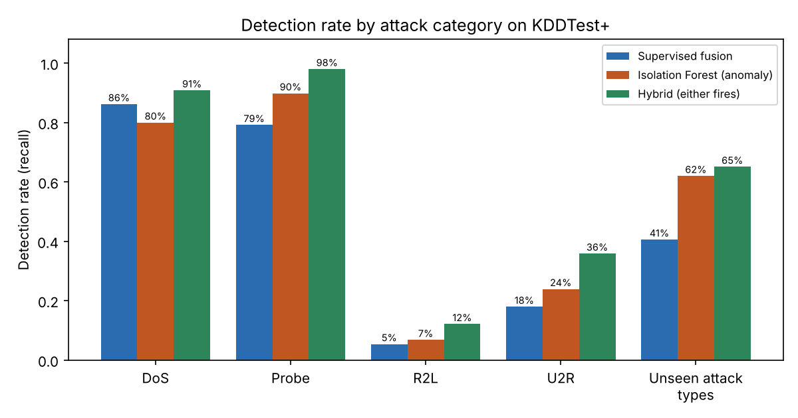
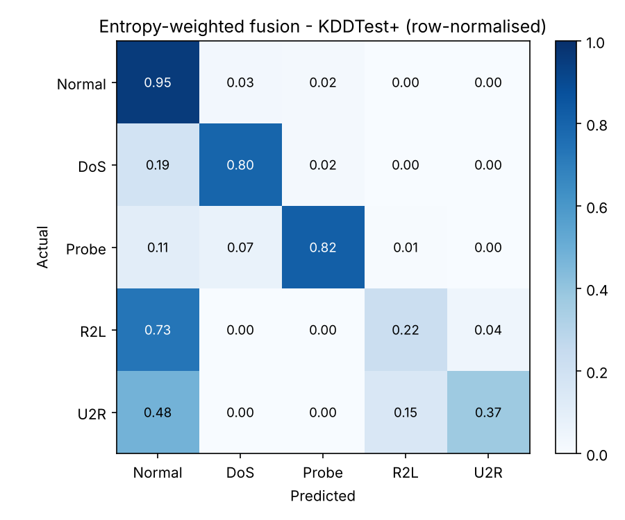
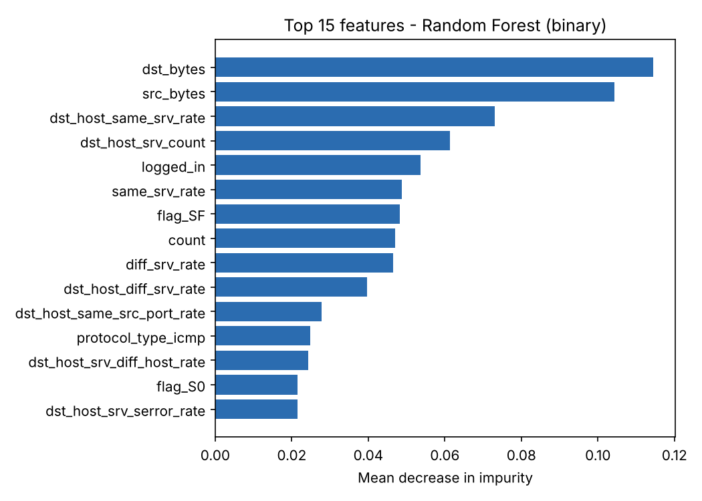

# ML Network Intrusion Detection — Layered Supervised + Anomaly Detection

A machine-learning intrusion detection system trained and evaluated on the **NSL-KDD** benchmark. It compares three supervised classifiers, fuses them with **entropy-weighted late fusion**, and adds an unsupervised **Isolation Forest** layer to catch attacks the supervised models have never seen.

   

## Key result

Supervised models are good at attacks they were trained on and poor at new ones. On the official test set, **17 attack types (3,750 connections) never appear in training**. The supervised fusion catches only **41%** of them. An anomaly detector trained *only on normal traffic* catches **62%**. Combining the two layers gives the best overall result:

| Detector (binary, KDDTest+) | F1 | Recall | Precision | False positive rate | Unseen-attack recall |
|---|---|---|---|---|---|
| Logistic Regression | 0.743 | 0.624 | 0.918 | 7.4% | — |
| Random Forest | 0.749 | 0.611 | 0.967 | 2.7% | — |
| Hist. Gradient Boosting | 0.804 | 0.686 | 0.970 | 2.8% | — |
| Entropy-weighted fusion | 0.788 | 0.663 | 0.970 | 2.7% | 40.6% |
| Isolation Forest (anomaly only) | 0.780 | 0.651 | 0.975 | 2.2% | 62.0% |
| **Hybrid: fusion OR anomaly** | **0.840** | **0.742** | 0.968 | 3.2% | **65.1%** |

Adding the anomaly layer raised F1 from 0.804 (the best single model) to **0.840**, at a cost of only 0.4 percentage points more false positives (2.8% → 3.2%).



## Why this matters for a SOC

- **Signature-like models miss novel attacks.** Training data is always behind attackers. The `mscan`, `saint` and `processtable` attacks in the test set are exactly that situation.
- **Anomaly detection is the safety net**, but alone it is noisy and can't say *what* the attack is. The hybrid uses the supervised model for known threats and the anomaly model for unknowns. This is the same defence-in-depth idea a SOC uses when it pairs SIEM correlation rules with UEBA.
- **False positives are a cost.** Every result above reports the false positive rate, because a detector that alerts on 7% of normal traffic (Logistic Regression) would bury analysts.

## Entropy-weighted fusion

This method is adapted from my IEEE paper on fusing multiple models for melanoma detection (IITCEE 2026). Each model's vote is weighted **per sample** by how certain it is, measured with normalised Shannon entropy:

```
H_m(x) = -Σ_k p_mk(x) · log p_mk(x) / log K      (0 = certain, 1 = guessing)
w_m(x) = 1 - H_m(x), normalised across models
p(x)   = Σ_m w_m(x) · p_m(x)
```

**Honest finding:** on NSL-KDD, fusion beat Logistic Regression, Random Forest and plain soft voting (F1 0.788 vs 0.786). It did **not** beat Gradient Boosting alone (0.804). Here the three models make *correlated* errors: they all miss R2L attacks for the same reason, too few training examples. Fusion only helps when models fail differently. The anomaly layer helped more because it fails in a different way. This is why I treat model diversity, not model count, as the design goal.

## Multi-class results (Normal / DoS / Probe / R2L / U2R)



| Class | Train rows | Test rows | Precision | Recall | F1 |
|---|---|---|---|---|---|
| Normal | 67,343 | 9,711 | 0.709 | 0.954 | 0.813 |
| DoS | 45,927 | 7,458 | 0.934 | 0.796 | 0.859 |
| Probe | 11,656 | 2,421 | 0.862 | 0.819 | 0.840 |
| R2L | 995 | 2,887 | 0.951 | 0.224 | 0.362 |
| U2R | 52 | 67 | 0.158 | 0.373 | 0.222 |

The confusion matrix explains the weakness. **73% of R2L attacks are classified as Normal**: there are 995 R2L training examples, yet 2,887 R2L rows to test on, many of them new types. R2L attacks (password guessing, `snmpguess`, `httptunnel`) also look like legitimate sessions at the flow level. Detecting them reliably needs payload or authentication-log data, not connection statistics alone. Class weighting is already applied.

## What the model looks at



Byte counts and host-level service rates dominate. These are traffic-volume and connection-pattern signals, which is why DoS and Probe are detected well and stealthy R2L is not.

## Run it

```bash
pip install -r requirements.txt
python data/download.py           # NSL-KDD (≈19 MB), row counts verified
python src/train.py               # ≈1.5 min on a laptop CPU → results/ and models/
python src/predict.py data/KDDTest+.txt --limit 8
python -m unittest discover -s tests
```

Sample `predict.py` output. The `mscan` row is an attack type absent from training: only the anomaly layer catches it.

```
protocol service  flag  p_attack anomaly_score supervised_alert anomaly_alert verdict true_label
     tcp private   REJ     1.000         0.596             True          True   ALERT    neptune
    icmp   eco_i    SF     0.972         0.494             True         False   ALERT      saint
     tcp  telnet  RSTO     0.045         0.559            False          True   ALERT      mscan
     tcp  telnet    SF     0.018         0.378            False         False      ok guess_passwd
```

## Project structure

```
src/features.py   schema, attack → category taxonomy, MITRE ATT&CK mapping, preprocessing
src/fusion.py     entropy-weighted fusion + scikit-learn compatible ensemble
src/train.py      all experiments, metrics.json and figures
src/predict.py    layered scoring of new connection records
tests/            unit tests for fusion maths and taxonomy
results/          metrics.json and figures from the last run
```

## Methodology notes

- Trained on `KDDTrain+`, evaluated only on the separate `KDDTest+`. There is no random split, because a random split leaks attack types between train and test and inflates results to ~99%.
- The anomaly threshold is the 95th percentile of scores on **normal training traffic**, so no test labels are used for tuning.
- Fixed random seed (42); all numbers above come from `results/metrics.json`.
- Trained models are not committed. `.joblib` files are pickles, and loading one from an untrusted source can execute code.

## Limitations and next steps

- NSL-KDD is from 1998-era traffic and is a benchmark, not a picture of today's networks. Next step: repeat the experiment on **CIC-IDS2017 / UNSW-NB15**.
- Add SHAP explanations per alert, so an analyst can see *why* a connection was flagged.
- Replace the OR rule with a learned meta-classifier, and tune the anomaly threshold against an alert budget.

---
Dataset: M. Tavallaee, E. Bagheri, W. Lu, A. Ghorbani, *"A Detailed Analysis of the KDD CUP 99 Data Set,"* IEEE CISDA 2009.

## Author

**Sparsh Khanal** · [GitHub](https://github.com/Sparsh-khanal75) · [LinkedIn](https://www.linkedin.com/in/Sparsh-khanal75)
